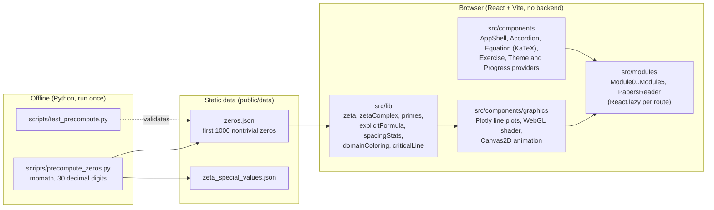

# Riemann Hypothesis: An Interactive Study App

A static React + TypeScript web app that teaches the Riemann Hypothesis step by step, with interactive graphics computed live in the browser and high-precision zeta zeros precomputed offline in Python.

> This project visualizes and explains the Riemann Hypothesis. It does not prove it. The hypothesis is still an open problem, and the app says so explicitly in its content.

## What it solves and what it does

The Riemann Hypothesis is usually presented either as a one-line statement or buried in dense literature. This app builds the path in between: from prime numbers up to the statement of the hypothesis and the current state of research, with every derivation shown step by step and every concept tied to a graphic you can manipulate.

- Six learning modules plus a papers reader, each with three levels of explanation, collapsible step-by-step derivations rendered with KaTeX, and exercises with numeric answer checking.
- Seven interactive graphics:
  - G1: prime counting function pi(x) against x/ln x and li(x).
  - G2: zeta on the real line, with a bounded slider and an honest note on where the direct series converges poorly.
  - G3: domain coloring of zeta(s) in the complex plane, rendered by a WebGL fragment shader, with zoom, pan, pinch and a cursor readout. The critical line and the first precomputed zeros are drawn on top.
  - G4 and G5: |zeta(1/2 + it)| and the Hardy Z function along the critical line.
  - G6: an animation of the explicit formula, where the waves contributed by N zeta zeros (N from 0 to 200) progressively rebuild the Chebyshev psi(x) prime staircase.
  - G7: histogram of normalized spacings between real zeta zeros against the GUE (Wigner surmise) curve.
- Progress tracking and light/dark theme persisted in the browser.
- Content that keeps evidence and proof apart: numerical verification of many zeros is presented as evidence, not as a proof, and claimed "proofs" are labeled as unvalidated.

The UI text of the app is in Spanish.

## Architecture



How the pieces fit:

- Hybrid computation. The expensive, precision-critical part (locating zeta zeros) runs offline: `riemann-app/scripts/precompute_zeros.py` calls `mpmath.zetazero(k)` at 30 decimal digits and writes `zeros.json` and `zeta_special_values.json` with deterministic serialization, so a rerun with the same parameters produces identical files. At runtime the app only reads these JSON files and never calls Python.
- Math in TypeScript. `src/lib` holds pure, unit-tested functions: the direct Dirichlet series on the reals (`zeta.ts`), complex zeta through the Dirichlet eta function plus the functional equation with a Lanczos Gamma for the left half-plane (`zetaComplex.ts`), the Hardy theta and Z functions, prime counting and li(x) (`primes.ts`), the truncated explicit formula for psi(x) (`explicitFormula.ts`), and unfolded zero spacings with the GUE curve (`spacingStats.ts`).
- Rendering. Line plots use Plotly (basic bundle). The domain coloring is a GLSL fragment shader that evaluates eta with 200 terms per pixel (hue = phase, brightness = modulus); the exact zero positions overlaid on it come from `zeros.json`, not from the shader. The explicit formula animation uses Canvas2D. Every graphic is wrapped in an error boundary and has a fallback when WebGL or canvas is unavailable.
- App shell. React Router with a hash router, one lazily loaded chunk per module, and Plotly, KaTeX and the router split into their own vendor chunks in `vite.config.ts`. Theme and progress live in React context providers backed by `localStorage`.
- Planning documents. The root `riemann-roadmap.md` and `riemann-fase-*.md` files are the phase-by-phase plan the app was built from (in Spanish).

## Tech stack

- React 19, TypeScript, Vite, React Router 7
- KaTeX for equations, Plotly (`plotly.js-basic-dist-min`) for line plots, WebGL for domain coloring, Canvas2D for animation
- Tailwind CSS 3 (class-based dark mode)
- Vitest, React Testing Library, jsdom; oxlint for linting
- Python 3 with mpmath 1.3.0 for offline precomputation

## Results

- Precomputed data: `riemann-app/public/data/zeros.json` contains 1000 nontrivial zeros (`"count": 1000`), computed at 30 decimal digits. The first is at t = 14.134725141734695 and the 1000th at t = 1419.4224809459956. The file stores the imaginary parts; the real part 1/2 is recorded as a constant, since these computed zeros lie on the critical line. That is a numerical fact about these 1000 zeros, not a proof of the hypothesis.
- Frontend tests: `npm test` passes 122 of 122 tests across 34 test files (Vitest 4.1.9). They check the math against known values such as zeta(2) = pi^2/6, zeta(0) = -1/2, the first zero near t = 14.1347, and psi(10) = 7.832.
- Python tests: `scripts/test_precompute.py` defines 4 tests: ground truth for the first zeros, file structure, |zeta(1/2 + it)| below 1e-8 at the stored zeros, and special values.
- `npm run build` completes without warnings.

## Running locally

Requirements: Node.js and npm. Python 3 only if you want to regenerate the data.

```bash
cd riemann-app
npm ci
npm run dev        # development server
npm test           # run the Vitest suite once
npm run lint       # oxlint
npm run build      # type-check and production build into dist/
npm run preview    # serve the production build
```

The Vite config sets `base: '/riemann/'`, so the dev and preview servers serve the app under the `/riemann/` path.

Regenerating the precomputed data (optional; about 3 minutes for 1000 zeros):

```bash
cd riemann-app
pip install -r scripts/requirements.txt
python scripts/precompute_zeros.py         # default N = 1000
python scripts/precompute_zeros.py 200     # or a different N
python scripts/test_precompute.py
```

## What I learned / key technical decisions

- I split the work by precision. Locating zeros needs arbitrary precision, so I do it once offline with mpmath and ship JSON. Drawing the landscape only needs to be fast and qualitatively right, so the shader uses 200 eta terms and the exact zero markers come from the data file.
- I computed complex zeta through the Dirichlet eta function, eta(s) / (1 - 2^(1-s)), because it converges inside the critical strip where the plain series does not. I used the functional equation with a Lanczos Gamma to reach the left half-plane and the trivial zeros. Convergence on the critical line is slow, so the tests use realistic tolerances and the limits are documented (Riemann-Siegel would be the next step for large t).
- I kept all the math and view logic in pure functions in `src/lib` (screen-to-plane mapping, zoom and pan, pinch, sampling, scales) so it can be tested in jsdom without WebGL or canvas. The test setup forces `getContext` to return null so the graphics fall back deterministically.
- For the explicit formula I animated Chebyshev psi(x) instead of pi(x), because its main term is simply x. I wrote each conjugate pair of zeros as a single real wave, 2 sqrt(x) [ (1/2) cos(t ln x) + t sin(t ln x) ] / (1/4 + t^2), which makes the role of the real part 1/2 visible in the amplitude.
- I treated performance and robustness as part of the teaching. Switching to the basic Plotly bundle, lazy-loading each module, wrapping every graphic in an error boundary, and respecting reduced-motion preferences keep the app usable on modest hardware and on touch devices.

## Author

Washington Quevedo

- LinkedIn: https://www.linkedin.com/in/wxquevedo
- GitHub: https://github.com/wx-quevedo
